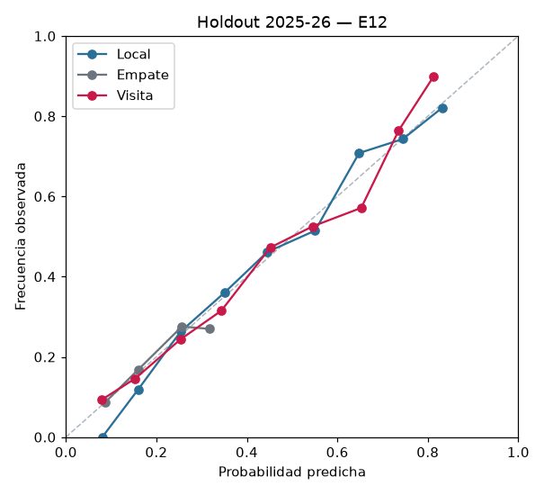
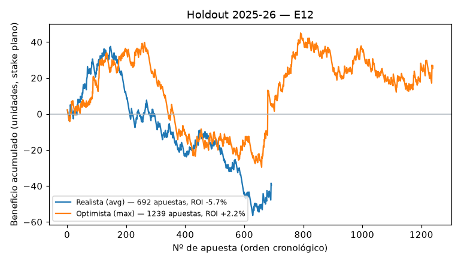

# Informe final — Modelo de predicción 1X2 (spec 001)

## Resumen

- El campeón **E12** (lightgbm_optuna[elo+form+schedule+xg+market]) alcanza el nivel **Bueno** del criterio de éxito en el holdout 2025-26: log loss 0.9810 frente a 0.9777 del mercado promedio pre-cierre (umbral de Bueno: 0.9827).
- **El modelo no le gana al mercado.** Es 0.0033 peor que usar directamente las probabilidades del mercado (IC 95 % [-0.0008, 0.0074]). El nivel Bueno depende de la tolerancia de +0.005 y el IC la contiene, así que el resultado no es concluyente.
- Sin cuotas, el mejor modelo (E06) logra 0.9934: mejora a las frecuencias (1.0712) y al Elo de E02 (0.9984) pero queda lejos del mercado.
- Apostar con el campeón no es rentable: 692 apuestas con cuota promedio, ROI -5.7 % (IC 95 % [-15.8 %, +5.5 %]) y CLV -6.3 % frente al cierre de Pinnacle.

## 1. Datos

Cinco grandes ligas (E0, SP1, D1, I1, F1), temporadas 2014-15 a 2024-25 para entrenar y validar (19 837 partidos) y 2025-26 como holdout (1 752 partidos), con resultados y cuotas de football-data.co.uk y xG de Understat (emparejamiento 100 % tras la segunda pasada). Detalle en [`data_quality.md`](data_quality.md).

## 2. Validación

Walk-forward por temporada con ventana expansiva: F1 valida en 2022-23, F2 en 2023-24 y F3 en 2024-25, entrenando con todas las temporadas anteriores. Los hiperparámetros (ξ, Optuna, calibración, pesos) se eligen solo con la última temporada de entrenamiento de cada fold. Métrica principal: log loss multiclase (menor es mejor).

## 3. Experimentos

| ID | Modelo | Cuotas | F1 | F2 | F3 | Media | ECE | Apuestas | ROI | IC 95 % ROI | Conclusión |
|---|---|---|---|---|---|---|---|---|---|---|---|
| E01-freq | frequencies | no | 1.0630 | 1.0763 | 1.0785 | **1.0726** | 0.017 | 5116 | -16.1 % | [-21.6 %, -10.8 %] | Piso: 1.0726. Cualquier modelo útil debe bajar claramente de aquí. |
| E01-avg | market_avg_shin | sí | 0.9776 | 0.9545 | 0.9631 | **0.9651** | 0.022 | 0 | — | — | Techo realista: 0.9651 (Shin). Meta nivel Bueno: <= 0.9701 en validación. |
| E01-avg_prop | market_avg_proportional | sí | 0.9779 | 0.9556 | 0.9638 | **0.9657** | 0.024 | 0 | — | — | Proporcional 0.9657, apenas peor que Shin (0.9651): se mantiene Shin como método principal. |
| E01-psc | market_psc_shin | sí | 0.9747 | 0.9519 | 0.9600 | **0.9622** | 0.018 | 521 | +22.6 % | [+6.4 %, +40.4 %] | Referencia sharp: 0.9622 (meta Excelente). Su ROI/CLV no es alcanzable: apuesta con información de cierre; solo referencia. |
| E02 | logistic[elo] | no | 0.9898 | 0.9758 | 0.9864 | **0.9840** | 0.018 | 2759 | -10.1 % | [-16.4 %, -3.5 %] | Confirmada: 0.9840 vs 1.0726 de frecuencias (-0.089), estable en los 3 folds y ECE 0.018. Queda a 0.019 del mercado Avg; referencia de estabilidad para el campeón. |
| E03 | poisson_goals_xi0.0019 | no | 0.9969 | 0.9783 | 0.9852 | **0.9868** | 0.015 | 4199 | -15.8 % | [-20.7 %, -10.9 %] | Rechazada: 0.9868, peor que Elo (0.9840), sobre todo en F1. Mejor ECE (0.015). Re-ejecutado tras T025 (equipos inactivos >365 días como ascendidos). |
| E04 | dixon_coles_goals_xi_tuned | no | 0.9975 | 0.9763 | 0.9849 | **0.9862** | 0.018 | 4104 | -15.8 % | [-20.4 %, -10.9 %] | Parcial: rho mejora algo a E03 (0.9862 vs 0.9868) pero sigue peor que Elo (0.9840). xi elegido en validación interna 0.001/0.0019/0.0019. Candidato para blend (E11). Re-ejecutado tras T025. |
| E05 | logistic[elo+form+schedule] | no | 0.9800 | 0.9774 | 0.9832 | **0.9802** | 0.019 | 4324 | -7.3 % | [-11.6 %, -2.8 %] | Confirmada en media: 0.9802 vs 0.9840 de E02 (-0.0038); mejora en F1 y F3 pero es 0.0016 peor en F2. C=0.05 fijado a priori. Nuevo mejor sin cuotas. |
| E06 | logistic[elo+form+schedule+xg] | no | 0.9797 | 0.9777 | 0.9811 | **0.9795** | 0.025 | 3565 | -8.0 % | [-12.6 %, -3.0 %] | Débil: 0.9795 vs 0.9802 (-0.0007 < 0.002); peor que E02 en F2 y ECE 0.025 (F3 0.028, cerca del límite 0.03). Con forma ya incluida el xG aporta poco en un modelo lineal. Siguiente: no linealidades (E07) y xG en ratings (E09). |
| E07 | xgboost[elo+form+schedule+xg] | no | 0.9835 | 0.9744 | 0.9805 | **0.9795** | 0.022 | 2291 | -7.2 % | [-14.3 %, +0.1 %] | Rechazada: 0.97948, igual que E06 (0.9795); mejor en F2 y F3 pero peor en F1. ECE 0.0225. Sin ajuste, la no linealidad no aporta; E08 prueba el ajuste de hiperparámetros. |
| E08 | lightgbm_optuna[elo+form+schedule+xg] | no | 0.9821 | 0.9735 | 0.9800 | **0.9785** | 0.016 | 4163 | -9.1 % | [-14.2 %, -3.8 %] | Mejora marginal: 0.97852 vs 0.9795 (-0.001 < 0.002); mejor en los 3 folds que E07 y mejor ECE (0.016). Nuevo mejor sin cuotas, pero la familia sin cuotas se estanca en ~0.979. |
| E09 | dixon_coles_xg_xi_tuned | no | 0.9923 | 0.9771 | 0.9778 | **0.9824** | 0.017 | 4045 | -13.8 % | [-18.6 %, -8.6 %] | Confirmada frente a E04 (0.9824 vs 0.9862: xG estima mejor la fuerza que los goles; F3 0.9778 es el mejor F3 sin cuotas) pero no mejora al mejor sin cuotas (E08 0.9785). Cuarto seguido sin mejora > 0.002: se detiene la familia sin cuotas (E10/E11 no se corren). |
| E12 | lightgbm_optuna[elo+form+schedule+xg+market] | sí | 0.9780 | 0.9635 | 0.9667 | **0.9694** | 0.020 | 3340 | -8.9 % | [-14.3 %, -3.2 %] | Hipótesis rechazada: 0.9694 es peor que el mercado Avg solo (0.9651); el boosting no extrae valor extra del mercado. Aun así cumple el umbral de nivel Bueno en validación (<= 0.9701) -> parada anticipada (experiments.md §1.5). |

Figuras por experimento en [`figures/`](figures/) (`{ID}_calibration.png`, `{ID}_roi.png`). El ROI de validación es optimista: el umbral de apuesta se elige sobre las mismas predicciones (ver `decisions.md`).

**Regla de parada.** La familia sin cuotas se detuvo tras E09 (4 experimentos seguidos sin mejorar el mejor log loss en más de 0.002); E12 alcanzó en validación el umbral del nivel Bueno (≤ mercado Avg + 0.005), lo que activa la parada anticipada. No se corrieron: E10, E11, E13, E14, E15. La aplicación de la regla por familia se decidió después de ver E06–E08 (registrada antes de E09 en `decisions.md`); con la regla global literal no se habría probado ningún modelo con cuotas.

## 4. Campeón y por qué

Regla: experiments.md §4: candidatos con ECE < 0.03 y ningún fold peor que E02 por más de 0.01; gana el menor log loss medio F1–F3; un candidato más simple a menos de 0.001 gana (logística < Poisson/DC < blend < boosting < stacking). Solo métricas de validación; el holdout no se usa.

| Rol | ID | Modelo | Log loss val. | Brier | ECE | Umbral | Motivo |
|---|---|---|---|---|---|---|---|
| Campeón | E12 | lightgbm_optuna[elo+form+schedule+xg+market] | 0.9694 | 0.5761 | 0.020 | 0.02 | menor log loss medio de validación (0.96943) |
| Mejor sin cuotas | E06 | logistic[elo+form+schedule+xg] | 0.9795 | 0.5838 | 0.025 | 0.05 | desempate por simplicidad: E06 (0.97950) está a menos de 0.001 de E08 (0.97852) y es un modelo más simple |

Excluidos: E01-freq: línea base (referencia, no candidato); E01-avg: línea base (referencia, no candidato); E01-avg_prop: línea base (referencia, no candidato); E01-psc: línea base (referencia, no candidato).

## 5. Evaluación final en el holdout 2025-26

Evaluado una sola vez (2026-09-27T00:22:42+00:00, commit `141172c`), entrenando con 2014-15…2024-25. 1752 partidos.

| Modelo | Log loss | Brier | RPS | ECE | Acierto |
|---|---|---|---|---|---|
| Campeón | 0.9810 | 0.5837 | 0.1978 | 0.019 | 0.527 |
| Mejor sin cuotas | 0.9934 | 0.5918 | 0.2018 | 0.013 | 0.525 |
| E02 (logística Elo) | 0.9984 | 0.5960 | 0.2043 | 0.022 | 0.514 |
| Frecuencias por liga | 1.0712 | 0.6477 | 0.2288 | 0.002 | 0.440 |
| Mercado Avg pre-cierre (Shin) | 0.9777 | 0.5822 | 0.1975 | 0.028 | 0.534 |
| Pinnacle cierre con relleno de frecuencias* | 1.0170 | 0.6104 | 0.2110 | 0.017 | 0.487 |

\* Pinnacle solo publica cuotas de cierre para el 51 % del holdout; en el resto esa fila usa frecuencias, así que no es la línea base de Pinnacle. La comparación válida es sobre el subconjunto:

| Subconjunto con cierre de Pinnacle | n | Campeón | Sin cuotas | Mercado Avg | Pinnacle cierre |
|---|---|---|---|---|---|
|  | 898 | 0.9664 | 0.9807 | 0.9610 | 0.9632 |

Diferencias de log loss por partido (IC 95 % bootstrap pareado, 2000 remuestreos; negativo = el primero es mejor):

| Comparación | Diferencia media | IC 95 % |
|---|---|---|
| champion − E01-avg | 0.0033 | [-0.0008, 0.0074] |
| champion − E02 | -0.0174 | [-0.0260, -0.0089] |
| champion − E01-freq | -0.0902 | [-0.1087, -0.0709] |
| champion − champion_no_odds | -0.0124 | [-0.0194, -0.0053] |
| champion_no_odds − E02 | -0.0050 | [-0.0119, 0.0016] |

## 6. Simulación de apuestas en el holdout

Una apuesta por partido (la de mayor EV) si EV = p × cuota − 1 supera el umbral fijado en validación. Stake plano de 1 unidad y Kelly 25 % con tope del 2 % del bankroll. CLV = cuota tomada / cuota justa de cierre de Pinnacle − 1 (solo donde existe).

| Modelo | Cuotas | Umbral EV | Apuestas | Acierto | ROI plano | IC 95 % | Máx. drawdown (u) | CLV medio | ROI Kelly | Bankroll final Kelly |
|---|---|---|---|---|---|---|---|---|---|---|
| Campeón | Realista (Avg) | 0.02 | 692 | 35.7 % | -5.7 % | [-15.8 %, +5.5 %] | 93.9 | -6.3 % | -5.0 % | 0.706 |
| Campeón | Optimista (Max) | 0.02 | 1239 | 36.1 % | +2.2 % | [-7.0 %, +12.4 %] | 69.4 | -1.7 % | +0.5 % | 1.074 |
| Mejor sin cuotas | Realista (Avg) | 0.05 | 941 | 30.8 % | -15.5 % | [-24.3 %, -6.3 %] | 158.7 | -6.8 % | -19.5 % | 0.111 |
| Mejor sin cuotas | Optimista (Max) | 0.05 | 1284 | 32.2 % | -7.6 % | [-15.8 %, +0.4 %] | 119.6 | -2.9 % | -12.9 % | 0.128 |

Ningún intervalo de ROI es enteramente positivo y el CLV medio es negativo en todos los casos: no hay evidencia de ventaja frente al mercado. El escenario optimista (mejor cuota entre casas) mejora el ROI porque la mejor cuota tiene margen casi nulo, lo que anticipa el valor del comparador de la spec 002, pero su IC también incluye el 0.

## 7. Análisis por liga (holdout, log loss)

| Liga | Campeón | Sin cuotas | Mercado Avg | Frecuencias |
|---|---|---|---|---|
| D1 | 0.9473 | 0.9600 | 0.9518 | 1.0707 |
| E0 | 1.0275 | 1.0289 | 1.0160 | 1.0835 |
| F1 | 0.9753 | 0.9838 | 0.9723 | 1.0625 |
| I1 | 0.9798 | 1.0021 | 0.9800 | 1.0884 |
| SP1 | 0.9673 | 0.9837 | 0.9622 | 1.0489 |

El campeón iguala o mejora al mercado (±0.0005) en: D1, I1; en el resto queda por detrás. La liga más difícil de predecir para el mercado es E0.

## 8. Nivel alcanzado: Bueno

| Condición (spec §6) | Cumple |
|---|---|
| Mínimo: mejor que frecuencias | ✅ |
| Mínimo: mejor que E02 (Elo) | ✅ |
| Mínimo: ECE < 0.03 | ✅ |
| Bueno: ≤ mercado Avg + 0.005 | ✅ |
| Excelente: < Pinnacle al cierre (subconjunto) | ❌ |
| Excelente: ROI > 0 con IC sin 0 y ≥ 300 apuestas | ❌ |

## 9. Limitaciones

- **El campeón es peor que el mercado solo**, en validación (los tres folds) y en el holdout. Para estimar probabilidades es preferible usar el mercado directamente; el modelo sirve como sistema completo (con versión sin cuotas) pero no aporta ventaja.
- El nivel Bueno se apoya en la tolerancia de +0.005, y el IC de la diferencia con el mercado la contiene: con otra temporada podría no cumplirse.
- E13 (stacking de modelo sin cuotas + mercado), la vía natural para no quedar por debajo del mercado, no se probó por la regla de parada. Tampoco E10, E11, E14 ni E15.
- La regla de parada se aplicó por familia de modelos (decisión tomada tras ver E06–E08).
- Pinnacle dejó de aparecer en football-data a mitad de 2025-26: la línea base de cierre del holdout cubre solo ~51 % de partidos y en 2026-27 no hay Pinnacle. El mercado Avg de las temporadas recientes tiene más margen que en el entrenamiento.
- ECE sobre ~1 750 partidos es ruidoso; la condición ECE < 0.03 puede fallar por azar.
- El ROI de validación es optimista (el umbral se elige sobre las mismas predicciones).
- Features solo de liga: no hay copas ni competiciones europeas (el descanso y la congestión subestiman la carga real), ni lesiones o alineaciones.
- Temporadas 2014-15 a 2018-19 sin hora de inicio (se imputa 15:00 UK).

## 10. Próximos pasos

1. Probar E13 (stacking logístico sobre [p_sin_cuotas, p_mercado]) como nuevo ciclo de experimentos, con un holdout nuevo (2026-27 completo) para no reutilizar el actual.
2. Comparador de casas (spec 002): la mejor cuota reduce el margen a ~0 % y, en la simulación, lleva el ROI a ≈ 0 (sin evidencia de ventaja).
3. Features de alineaciones/lesiones y calendario europeo.
4. Seguimiento en vivo (US6) para acumular evidencia fuera de muestra en 2026-27.

> **Juego responsable.** Proyecto educativo. Ningún modelo garantiza ganancias y este, en particular, no muestra ventaja frente al mercado.
