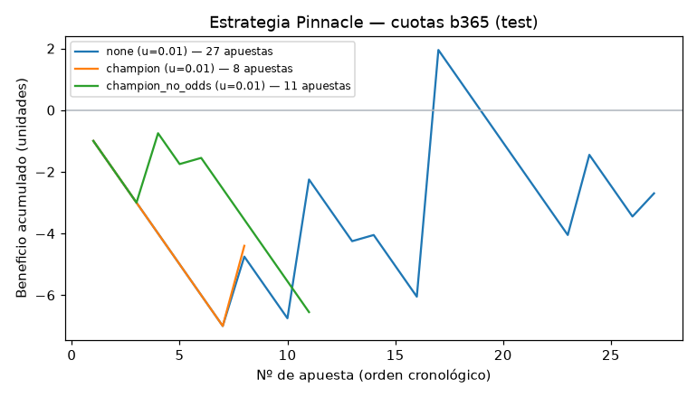

# Backtest de la estrategia de referencia Pinnacle (spec 002, US1)

## Resumen

- **Conclusión: SEGUIR CON CAMBIOS.** La estrategia principal no alcanza el nivel Bueno en el test, pero alguna variante con Bet365 tiene CLV positivo con IC 95 % por encima de 0 sumando validación y test, y CLV positivo en el test. Esa evidencia descansa sobre todo en la validación (el test tiene muy pocas apuestas): la confirmación real es la condición de la spec §5, **CLV medio > 0 en las primeras 100 apuestas en papel antes de apostar dinero real**.
- **Nivel (parte backtest de la spec §5): Mínimo (backtest).**
- Estrategia principal (declarada antes del test): Bet365 sin filtro. En el test 2025-26: **27 apuestas** (se esperaban ~23), ROI -10.0 % (IC 95 % [-77.0 %, +83.7 %]), CLV medio -3.74 % (IC 95 % [-8.0 %, +0.3 %], 27 apuestas con cierre de Pinnacle).
- Con 27 apuestas el test **no tiene potencia estadística**: el ROI es casi puro ruido y ni el nivel Bueno ni su ausencia son concluyentes. La evidencia principal es el CLV sumando validación y test.
- En validación, el ROI de Bet365 sin filtro (+31.5 % con 130 apuestas) fue suerte: su CLV era solo +0.9 % con un IC que incluía el 0.

## Método

- Probabilidad justa: Shin sobre las cuotas de Pinnacle **pre-cierre** (`ps_odds_*`). Las de cierre (`psc_odds_*`) solo se usan para medir el CLV.
- Se apuesta al resultado de mayor EV si `cuota × p_justa − 1 > umbral`, como máximo una apuesta por partido. Escenarios: Bet365 (`b365`, una casa blanda real, **decide la conclusión**), mejor cuota del mercado (`max`, solo informativo) y promedio (`avg`, control).
- Variantes: sin filtro, y con filtro del modelo (`p_modelo ≥ p_justa`) usando predicciones fuera de muestra del campeón E12 y del modelo sin cuotas E06.
- Umbral elegido en F1–F3 (2022-23, 2023-24, 2024-25): umbral de {0.01, 0.02, 0.03, 0.05} con mayor CLV medio en F1–F3 entre los que tienen ≥ 300 apuestas; empate o ninguno → el menor. "Por defecto" = ningún umbral llegó a 300 apuestas.
- Test: 2025-26 (1752 partidos), evaluado una sola vez (lock `HOLDOUT_002_USED.lock`).
- Cobertura de cuotas en el test: Pinnacle pre-cierre 51 %, Pinnacle cierre 51 %, Bet365 100 %, máx. 100 %. Sin Pinnacle no hay referencia ni apuesta. Cobertura de Pinnacle por liga: D1 49 %, E0 55 %, F1 50 %, I1 53 %, SP1 50 %.

## Validación F1–F3

| Cuotas | Variante | Umbral | Apuestas | Con CLV | Acierto | ROI plano | IC 95 % ROI | CLV medio | IC 95 % CLV | % CLV > 0 |
|---|---|---|---|---|---|---|---|---|---|---|
| mejor cuota (optimista, solo informativo) | sin filtro | 0.05 | 323 | 323 | 18.3 % | -13.0 % | [-35.3 %, +13.5 %] | +5.66 % | [+3.9 %, +7.5 %] | 68.1 % |
| mejor cuota (optimista, solo informativo) | filtro campeón E12 | 0.03 | 437 | 437 | 20.8 % | -17.9 % | [-34.8 %, +1.0 %] | +4.92 % | [+3.6 %, +6.2 %] | 72.5 % |
| mejor cuota (optimista, solo informativo) | filtro sin cuotas E06 | 0.03 | 316 | 316 | 23.1 % | -9.3 % | [-28.0 %, +11.1 %] | +6.17 % | [+4.9 %, +7.4 %] | 76.6 % |
| Bet365 (una casa blanda) | sin filtro | 0.01 (por defecto) | 130 | 130 | 24.6 % | +31.5 % | [-10.6 %, +82.8 %] | +0.91 % | [-1.1 %, +3.0 %] | 58.5 % |
| Bet365 (una casa blanda) | filtro campeón E12 | 0.01 (por defecto) | 49 | 49 | 20.4 % | +34.0 % | [-48.8 %, +134.3 %] | +3.35 % | [+0.3 %, +6.5 %] | 67.3 % |
| Bet365 (una casa blanda) | filtro sin cuotas E06 | 0.01 (por defecto) | 46 | 46 | 32.6 % | +84.8 % | [+5.1 %, +169.2 %] | +2.92 % | [+0.4 %, +5.6 %] | 65.2 % |
| promedio (control) | sin filtro | 0.01 (por defecto) | 10 | 10 | 10.0 % | -68.1 % | [-100.0 %, -4.3 %] | -11.66 % | [-22.4 %, -2.5 %] | 20.0 % |
| promedio (control) | filtro campeón E12 | 0.01 (por defecto) | 3 | 3 | 0.0 % | -100.0 % | [-100.0 %, -100.0 %] | -9.51 % | [-14.3 %, -1.0 %] | 0.0 % |
| promedio (control) | filtro sin cuotas E06 | 0.01 (por defecto) | 1 | 1 | 0.0 % | -100.0 % | [-100.0 %, -100.0 %] | +0.82 % | [+0.8 %, +0.8 %] | 100.0 % |

## Test (una sola vez)

| Cuotas | Variante | Umbral | Apuestas | Con CLV | Acierto | ROI plano | IC 95 % ROI | CLV medio | IC 95 % CLV | % CLV > 0 |
|---|---|---|---|---|---|---|---|---|---|---|
| mejor cuota (optimista, solo informativo) | sin filtro | 0.05 | 39 | 39 | 10.3 % | -51.5 % | [-95.4 %, +10.4 %] | +2.49 % | [-1.9 %, +6.8 %] | 59.0 % |
| mejor cuota (optimista, solo informativo) | filtro campeón E12 | 0.03 | 26 | 26 | 11.5 % | -56.2 % | [-100.0 %, +0.0 %] | +5.56 % | [+2.1 %, +9.1 %] | 73.1 % |
| mejor cuota (optimista, solo informativo) | filtro sin cuotas E06 | 0.03 | 31 | 31 | 6.5 % | -75.5 % | [-100.0 %, -37.3 %] | +3.27 % | [-0.3 %, +7.2 %] | 61.3 % |
| Bet365 (una casa blanda) | sin filtro | 0.01 | 27 | 27 | 22.2 % | -10.0 % | [-77.0 %, +83.7 %] | -3.74 % | [-8.0 %, +0.3 %] | 40.7 % |
| Bet365 (una casa blanda) | filtro campeón E12 | 0.01 | 8 | 8 | 12.5 % | -55.0 % | [-100.0 %, +35.0 %] | +1.08 % | [-3.3 %, +4.7 %] | 62.5 % |
| Bet365 (una casa blanda) | filtro sin cuotas E06 | 0.01 | 11 | 11 | 18.2 % | -59.5 % | [-100.0 %, +10.5 %] | -0.80 % | [-3.7 %, +2.0 %] | 45.5 % |
| promedio (control) | sin filtro | 0.01 | 6 | 6 | 33.3 % | -43.0 % | [-100.0 %, +15.3 %] | -9.18 % | [-21.9 %, +2.3 %] | 33.3 % |
| promedio (control) | filtro campeón E12 | 0.01 | 1 | 1 | 0.0 % | -100.0 % | [-100.0 %, -100.0 %] | -1.55 % | [-1.5 %, -1.5 %] | 0.0 % |
| promedio (control) | filtro sin cuotas E06 | 0.01 | 0 | 0 | — | — | — | — | — | — |

## Evidencia agrupada (validación + test) — Bet365

| Variante (Bet365) | Apuestas con CLV | CLV medio | IC 95 % |
|---|---|---|---|
| sin filtro | 157 | +0.11 % | [-1.7 %, +1.9 %] |
| filtro campeón E12 | 57 | +3.03 % | [+0.4 %, +6.0 %] |
| filtro sin cuotas E06 | 57 | +2.21 % | [+0.1 %, +4.5 %] |

## Placebo: CLV de la fuente de cuota sin ninguna selección

Si se apostara a todos los resultados a esa cuota. La diferencia con la tabla anterior es lo que aporta la regla de selección.

| Fuente de cuota (sin selección) | CLV validación | CLV test |
|---|---|---|
| mejor cuota | -0.58 % | -2.67 % |
| mejor cuota, cuota ≥ 5 | -1.57 % | -4.05 % |
| Bet365 | -6.14 % | -6.04 % |
| promedio | -5.24 % | -6.64 % |

## Detalle de la estrategia principal en el test

**Por liga**

| Grupo | Apuestas | ROI | CLV medio |
|---|---|---|---|
| D1 | 1 | +75.0 % | +2.18 % |
| E0 | 4 | +215.0 % | +1.29 % |
| F1 | 3 | -100.0 % | -4.86 % |
| I1 | 10 | -100.0 % | -4.43 % |
| SP1 | 9 | +10.6 % | -5.48 % |

**Por rango de cuota**

| Grupo | Apuestas | ROI | CLV medio |
|---|---|---|---|
| [1, 2) | 2 | +47.5 % | -0.36 % |
| [2, 3) | 1 | -100.0 % | +5.16 % |
| [3, 5) | 6 | +14.2 % | +0.47 % |
| ≥ 5 | 18 | -19.4 % | -6.01 % |

## Nivel alcanzado

| Condición | Cumple |
|---|---|
| minimo_clv_validacion | ✅ |
| bueno_clv_test | ❌ |
| bueno_roi_ci_low | ❌ |
| excelente_roi_ci_sin_cero | ❌ |
| seguir_con_cambios_clv_b365_agrupado_ic_positivo | ✅ |

El nivel Mínimo de la spec también exige el sistema completo (US2–US6) funcionando; aquí solo se evalúa la parte del backtest. Hay 6 variantes × 4 umbrales: sin corrección por comparaciones múltiples, un IC que apenas excluye el 0 es evidencia débil.

## Advertencias

- `max` (mejor cuota de football-data/Oddsportal) mezcla exchanges sin comisión y precios atípicos o desactualizados: en el 23 % de los partidos de validación la suma de 1/cuota es < 1 (arbitraje). Su CLV positivo mide que el precio máximo supera a Pinnacle, no que se pueda apostar a ese precio.
- En Bet365 el borde desaparece al subir el EV (validación: CLV +1.8 % con EV 1–3 %, −2.5 % con EV > 5 %): cuando la casa blanda se aleja mucho de Pinnacle pre-cierre, el precio desactualizado suele ser el de Pinnacle.
- Las casas limitan cuentas ganadoras; el backtest no lo modela. Las cuotas de football-data se toman en un momento fijo (normalmente viernes o martes).

> **Juego responsable.** Apostar implica riesgo de pérdida. Ningún backtest garantiza resultados futuros.
